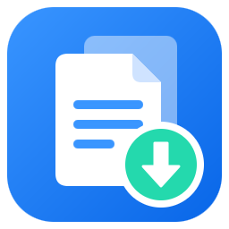
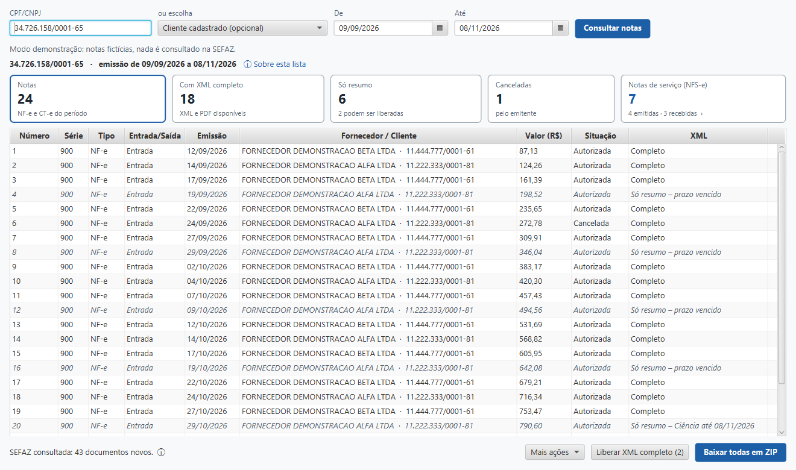
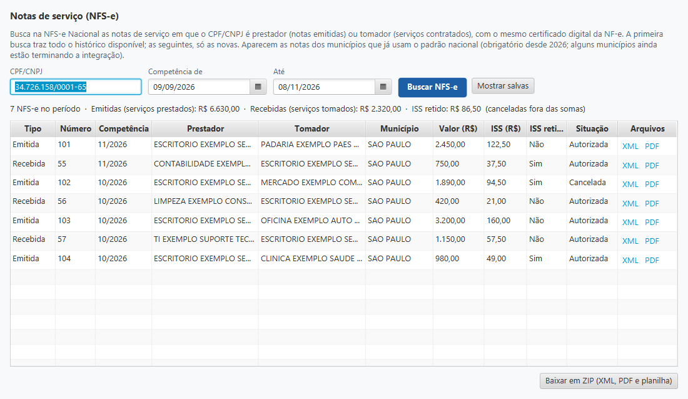

  

<h1 align="center">NotaBox</h1>

  <b>Todas as NF-e, CT-e e NFS-e dos seus clientes, direto da SEFAZ, em poucos cliques.</b> 
  NF-e, CT-e e NFS-e com XML e PDF · CNPJs ilimitados · Teste grátis por 3 dias

  

  Versão 0.2.31 · Windows 10 e 11 · Sem cartão para testar · <a href="https://notabox.pages.dev">Site oficial: notabox.pages.dev</a>

  

## Como instalar

1. **Clique no botão DOWNLOAD** acima. O instalador do NotaBox vai para a pasta *Downloads*.
2. **Abra o arquivo baixado** (clique duas vezes). Se o Windows mostrar um aviso azul, clique em **Mais informações** e depois em **Executar assim mesmo**.
3. **Pronto.** O NotaBox abre sozinho e o teste grátis de 3 dias já começa.

> Você só precisa do botão DOWNLOAD. Os outros arquivos que aparecem na lista de versões são usados pela atualização automática do programa — não é preciso baixá-los.

## O que o NotaBox faz

| | |
|---|---|
| 🏢 **CNPJs ilimitados** | Consulte quantos clientes quiser pelo mesmo valor. O plano só conta computadores. |
| 📄 **NF-e, CT-e e NFS-e** | Notas de produto e transporte pela SEFAZ e notas de serviço pela NFS-e Nacional. |
| 📦 **XML e PDF em ZIP** | DANFE e DACTE em PDF e o período inteiro em um ZIP, pronto para o seu sistema. |
| 🔐 **Certificado A1 e A3** | Usa o certificado digital que você já tem. |
| 💾 **Tudo no seu computador** | As notas ficam guardadas no PC; a próxima busca traz só o que é novo. |
| 🔄 **Sempre atualizado** | O programa se atualiza sozinho e tem suporte direto pela tela. |

  

## Planos

| Plano | Computadores | Mensal | Anual (14 meses pelo preço de 12) |
|---|---|---|---|
| Individual | 1 | R$ 199,90 | R$ 2.398,80 |
| Equipe | até 3 | R$ 349,90 | R$ 4.198,80 |
| Escritório | até 10 | R$ 599,90 | R$ 7.198,80 |

Pagamento por Pix ou cartão pelo Mercado Pago, direto no programa. Promoções em vigor aparecem no [site oficial](https://notabox.pages.dev) e na tela de assinatura do programa.

  

